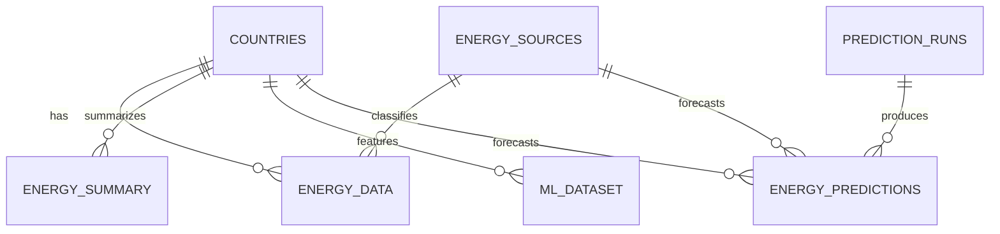

# Database and Dashboard Plan

## Recommended Responsibilities

- **MySQL is the source of truth** for cleaned energy measurements, dimensions, annual summaries, and structured predictions.
- **NoSQL is an optional dashboard read model** for denormalized country/year documents, dashboard preferences, or flexible model metadata. Do not treat it as a second authoritative copy of the CSVs.
- **Python is the integration layer**: it loads and validates the processed data, provides dashboard queries/API functions, and publishes selected read models to NoSQL.

The NoSQL product is not selected in this workspace. The plan below is vendor-neutral; the example document shape can be implemented in a document database such as MongoDB if that is the chosen technology.

## Proposed MySQL Tables

| MySQL table | CSV/source | Purpose and grain | Keys |
| --- | --- | --- | --- |
| `countries` | `processed/countries.csv` | One row per area (the file includes countries and aggregate regions); stores area name, ISO code, continent, area type, and Ember region. | PK `country_id`; unique natural key (`area`, `iso_code`). |
| `energy_sources` | `processed/energy_sources.csv` | One row per electricity source; stores its category and renewable/fossil/low-carbon/aggregated flags. | PK `source_id`; unique `electricity_source`. |
| `energy_data` | `processed/energy_data.csv` | Detailed measurements for one area, electricity source, and year. This is the normalized fact table for source-level analysis. | Composite PK (`country_id`, `source_id`, `year`); FKs to `countries.country_id` and `energy_sources.source_id`. |
| `energy_summary` | `processed/energy_summary.csv` | Annual total, renewable, and fossil generation measures for one area and year. | Composite PK (`country_id`, `year`); FK to `countries.country_id`. |
| `ml_dataset` | `processed/ml_dataset.csv` | Modeling features for one area and year, including lag and growth columns. Treat as a derived analytics table, not the canonical source of measurements. | Composite PK (`country_id`, `year`); FK to `countries.country_id`. |
| `energy_cleaned_staging` | `processed/energy_cleaned.csv` | Temporary landing/staging copy of the full cleaned source rows, including descriptive columns and both IDs. It overlaps with `energy_data`; keep it for reload/audit needs or drop it after successful loads. | Validate the same (`country_id`, `source_id`, `year`) grain; FKs to both dimensions if retained. |
| `prediction_runs` (future) | Prediction metadata | One row per model execution: model/version, training period, creation time, and evaluation metadata. | PK `run_id`. |
| `energy_predictions` (future) | Prediction output | One row per run, area, source (if predictions are source-specific), and forecast year; store estimate and optional bounds. | PK (`run_id`, `country_id`, `source_id`, `year`) for source-level forecasts; FKs to run and applicable dimensions. For area-level forecasts, omit `source_id` and use PK (`run_id`, `country_id`, `year`). |

Use InnoDB and foreign-key constraints. Use integer ID columns for the current CSV IDs, `SMALLINT`/`YEAR`-appropriate types for years, `DECIMAL` for measurements where exact decimal storage is desired, and nullable columns where the source has missing measurements. Confirm the exact precision and nullability from the loaded data before finalizing DDL. The current CSVs contain measurement values, not SQL constraint definitions.

`energy_cleaned.csv` is a useful interchange/staging file, but it is not necessary to store both it and `energy_data` permanently. For a normalized production schema, load it to staging, validate it, then populate `energy_data` and the derived tables.

## Relationships



For example, source-level dashboard rows can be joined to their labels with:

```sql
SELECT c.area, s.electricity_source, e.year, e.generation_twh
FROM energy_data AS e
JOIN countries AS c ON c.country_id = e.country_id
JOIN energy_sources AS s ON s.source_id = e.source_id;
```

Annual summary and ML queries join to `countries` by `country_id`; they do not join to `energy_sources` because they are already aggregated across sources.

## Post-Preprocessing Workflow

1. **Run preprocessing from top to bottom.** Generate the six current CSVs and require the notebook's primary-key, foreign-key coverage, and fact-grain assertions to pass. Keep the source CSV and preprocessing version/date with the load record.
2. **Create versioned staging tables.** Load the CSVs with Python using a MySQL driver/SQLAlchemy into staging tables for a specific batch ID. Do not load user-uploaded or regenerated CSV values directly into production tables.
3. **Validate the batch in Python and SQL.** Check expected columns and types, row counts, unique dimension keys, duplicate fact grain, null required IDs, and orphan IDs. Compare staging row counts with the notebook output. Reject the batch on any mismatch.
4. **Publish to MySQL in dependency order.** Within a controlled transaction, load `countries` and `energy_sources` first, then `energy_data`, followed by `energy_summary` and `ml_dataset`. If CSV-generated IDs are retained, replace the dataset as a whole and load explicit IDs consistently; do not append a regenerated CSV set to old rows. For incremental updates, use persistent MySQL dimension IDs and map natural keys (`area` + `iso_code`, and `electricity_source`) to those IDs rather than trusting newly generated CSV IDs.
5. **Commit only after constraints pass.** Keep foreign keys enabled. Reconcile inserted row counts and run orphan/uniqueness queries before marking the batch active. Retain the prior active batch or a backup so a failed refresh can be rolled back.
6. **Publish the NoSQL read model after the MySQL commit.** If the dashboard benefits from document reads, build one idempotent document per area/year (keyed by `country_id` and `year`) with summary values and optionally embedded source breakdowns. Include a dataset/batch version so a refresh replaces stale documents cleanly. Skip NoSQL if dashboard reads can be served efficiently from MySQL; it adds synchronization work and is not required just because both database types are in scope.
7. **Serve the dashboard through Python.** Put database access in a small service/repository layer. Use parameterized, read-only MySQL queries for filters and joins; query NoSQL only for its designated read models. Keep credentials in environment variables/secrets, not notebooks or source code. Use connection pooling, pagination for detailed rows, and caching only for expensive repeated dashboard queries.
8. **Add predictions as a separate versioned flow.** Save model outputs with `run_id`, model version, forecast year, and training cutoff. Load structured forecast rows into the future prediction tables; publish the same run/version to NoSQL only if needed for dashboard response speed. Never overwrite measured historical values with predictions.

## Key Stability Note

The current notebook assigns IDs from sorted dimension rows. That is deterministic for the same dimension contents, but inserting a new area/source can shift later IDs. For an initial full refresh, reload all dependent tables together with those IDs. Before implementing incremental production loads, move ID ownership to persistent MySQL dimensions and resolve CSV natural keys to database IDs during ingestion.